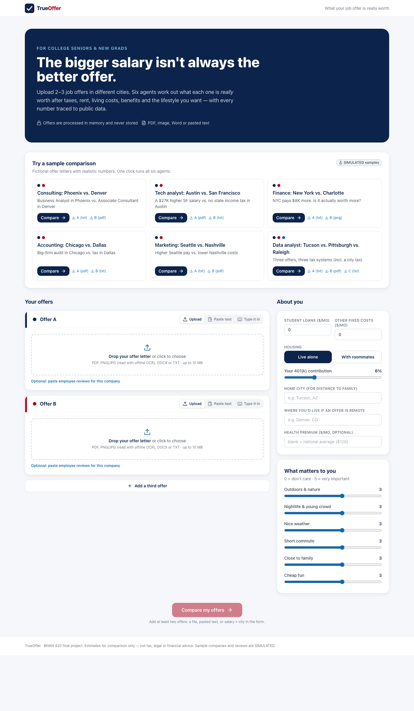
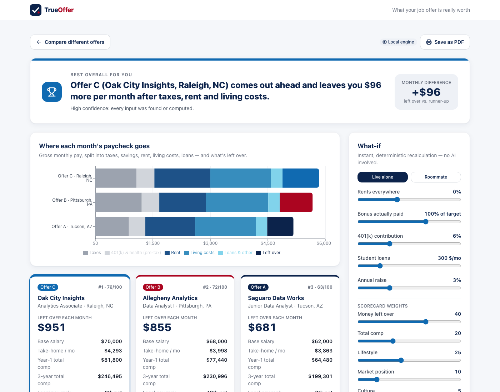
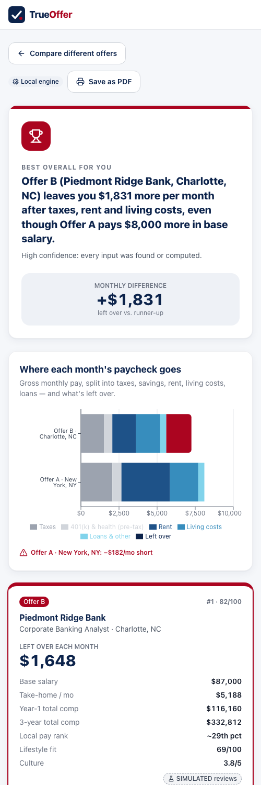

# TrueOffer

**The bigger salary isn't always the better offer.**

TrueOffer is a web-based, multi-agent AI product that helps college seniors and new grads compare 2–3 job offers in
different cities. Upload the offer letters (PDF, phone photo, Word or pasted text). Six specialized agents then work
out what each offer is *really* worth after taxes, rent, cost of living, benefits and the lifestyle you want. Every
number shows its formula and its public data source.

> **BNAN 420 · Project B: Build an Agentic AI Product** · Vibe coded with Claude Code · Runs with no API key and no
> paid services · Estimates for comparison, not tax, legal or financial advice.

| Deliverable | Where |
|---|---|
| 1. Working product | Live link: see [Deploying](#deploying) · or run locally with one double-click: [Run it locally](#run-it-locally) |
| 2. Architecture document (one page) | [docs/TrueOffer_Architecture.pdf](docs/TrueOffer_Architecture.pdf) (source: [architecture.html](architecture.html)) |
| 3. Demo video (2–3 min) | Script: [docs/DEMO_GUIDE.md](docs/DEMO_GUIDE.md) |
| 4. Source code + README | This repository |

| Home | Results | On a phone |
|---|---|---|
|  |  |  |

---

## Contents

- [The problem](#the-problem)
- [Features](#features)
- [Multi-agent design](#multi-agent-design)
- [Architecture](#architecture)
- [How each agent works](#how-each-agent-works)
- [Data sources](#data-sources)
- [Evaluation vs. ground truth](#evaluation-vs-ground-truth)
- [Privacy and responsible AI](#privacy-and-responsible-ai)
- [Run it locally](#run-it-locally)
- [Deploying](#deploying)
- [Tech stack](#tech-stack)
- [Limitations](#limitations)
- [Project structure](#project-structure)
- [Project history](#project-history)

---

## The problem

New grads usually compare offers by base salary. But a $95,000 offer in New York and an $87,000 offer in Charlotte
are not $8,000 apart once you account for:

- **Taxes:** state income tax ranges from 0% to over 9%, and some cities (NYC, Pittsburgh, Denver) add their own.
- **Rent:** the same apartment can cost twice as much in one metro as in another.
- **Everyday prices:** groceries, transportation, utilities and fun all vary by city.
- **Benefits:** 401(k) matches, signing bonuses, HSA money, equity and PTO differ, and letters describe them inconsistently.
- **Lifestyle:** weather, commute, outdoors, nightlife and distance from family.

TrueOffer turns those factors into one comparable number, **money left over each month**, and a weighted scorecard
based on what *you* care about. In that sample, Charlotte leaves about **$1,800 more per month**, while New York leaves
you **$182 short** each month.

## Features

- **Upload anything:** PDF offer letters, scanned images or phone photos (read with offline OCR), Word files, pasted
  emails, or a manual form. Compare 2 or 3 offers at once.
- **Six specialized agents and an orchestrator:** typed inputs and outputs, four agents running in parallel, and live
  progress streamed to the browser.
- **Real public data:** IRS 2026 tax rules, Tax Foundation state brackets, Zillow and Census rents, BLS spending and
  wages, BEA price levels and NOAA climate normals.
- **Money left over each month:** take-home pay minus rent, living costs, student loans and other fixed costs.
- **Weighted scorecard:** money, total compensation (1-year and 3-year), lifestyle fit, market position and culture,
  weighted by your priorities.
- **What-if sliders:** change housing, rent, bonus payout, 401(k), loans, raises or weights and see instant results.
- **What would flip the decision:** the app re-runs the math under different assumptions and tells you which ones
  change the winner.
- **Evidence for every number:** each extracted field shows its quote from the letter, or "not stated in offer."
  Every tax and budget line shows its formula and source.
- **Negotiation help:** a draft email to the recruiter built from BLS wage evidence, plus questions to ask about what
  each letter left out.
- **Under the hood:** each agent's engine, confidence, timing and step log.
- **Private by design:** offers are processed in memory only and never saved or logged.

## Multi-agent design

TrueOffer follows the course framework: each agent has one focused job, and the output of one is the input of the
next.

**The workflow, using the five brainstorm questions:**

| Question | TrueOffer |
|---|---|
| 1. Starting raw material? | 2–3 job offer letters (PDF, photo, Word, text) plus the student's profile and priorities |
| 2. What happens before a human sees it? | Extract the fields, compute taxes, price the city, benchmark the pay, score lifestyle fit |
| 3. Where does it end up? | A comparison dashboard: winner, monthly money left over, scorecard, what-ifs, negotiation email |
| 4. Distinct steps? | Six agents (below) |
| 5. Where does a human stay in the loop? | The student reviews every extracted field (with evidence), fills in what's "not stated," adjusts assumptions with what-if sliders, and edits and sends the negotiation email themselves. Nothing is sent automatically. |

**Each agent: input → job → output**

| # | Agent | Input | Job | Output (hand-off) |
|---|---|---|---|---|
| 1 | **Offer Parser** | One offer letter (file, text or form) | Read it (PDF text or OCR), extract 20 fields with evidence quotes, match the office to a metro | `OfferParserOutput`: structured fields + location |
| 2 | **Tax & Take-Home** | Salary, state, city, 401(k) %, health premium | 2026 federal, Social Security, Medicare, state and city income tax | `TaxOutput`: take-home pay + every tax line with formula and source |
| 3 | **Cost of Living & Housing** | Metro, housing choice, roommates | Market rent + everyday living costs scaled by local prices | `CostOfLivingOutput`: monthly city budget |
| 4 | **Market & Company** | Job title, metro, salary, company | Map the title to a BLS occupation, find the salary's local percentile, summarize culture | `MarketOutput`: percentile, leverage points, culture |
| 5 | **Lifestyle Fit** | Metro, the user's 0–5 priorities, home city | Score outdoors, nightlife, weather, commute, family distance and cost of fun | `LifestyleOutput`: fit score + dimension scores |
| 6 | **Decision Strategist** | Everything above + the profile | Money left over, weighted scorecard, tie detection, sensitivity, email, questions | `DecisionOutput`: the final report |

## Architecture

```
Browser (React) ── POST /api/compare ──► FastAPI ──► Orchestrator
     ▲                                                  │
     └──── Server-Sent Events: progress + result ◄──────┤
                                                        ▼
 Stage 1 (parallel, one per offer):  [1] Offer Parser
 Stage 2 (parallel, asyncio.gather): [2] Tax & Take-Home   [3] Cost of Living & Housing
                                     [4] Market & Company  [5] Lifestyle Fit
 Stage 3:                            [6] Decision Strategist
```

The one-page architecture document, with each agent, the data passed at each hand-off and how the orchestrator
coordinates, is **[docs/TrueOffer_Architecture.pdf](docs/TrueOffer_Architecture.pdf)**. Deeper technical notes are in
**[docs/ARCHITECTURE.md](docs/ARCHITECTURE.md)**.

- `backend/services/orchestrator.py` runs the three stages and passes a typed `PipelineState`
  (`backend/core/models.py`) between them.
- **Every agent has a timeout.** If one fails, the run still finishes with a clearly flagged partial result.
- **Each agent** lives in `backend/agents/<agent>.py`, exposes `async def run(inp) -> output`, has its own prompt in
  `backend/prompts/`, and reports `engine`, `confidence`, a step `log`, `warnings` and `elapsed_ms`.
- **All money math is deterministic Python** (`backend/core/finance.py`, `backend/core/scoring.py`). The what-if
  endpoint `/api/recalculate` reuses the same code, so the sliders always agree with the report.
- **Generated text is checked** by `backend/core/guards.py`, which rejects any dollar figure the engine didn't compute.

## How each agent works

**1. Offer Parser.** It identifies the file type from its bytes, then reads it with pdfplumber, offline OCR
(RapidOCR, for scans and photos), python-docx, or as plain text. A local rules engine splits the letter into
sentences, bullets and "Label: value" lines. It classifies each dollar amount by the nearest compensation keyword
(base, signing, relocation, HSA, equity, bonus; reimbursements are ignored). It also reads 401(k) formulas (tiered,
dollar-for-dollar, safe harbor), bonus targets, PTO, start date and work arrangement. Anything the letter doesn't say
is marked **"not stated in offer"** and never guessed. The office city is matched to one of the 52 largest U.S. metros.

**2. Tax & Take-Home.** It applies 2026 federal brackets and the standard deduction (IRS Rev. Proc. 2025-32), Social
Security up to the $184,500 wage base, Medicare, Tax Foundation 2026 state brackets with state-specific rules, and
city income taxes (NYC, Pittsburgh, Denver and others). The 401(k) contribution and health premium come out pre-tax.

**3. Cost of Living & Housing.** Rent is Zillow's latest typical rent, scaled to the right apartment size using
Census ACS rents by bedroom count. Living alone means a 1-bedroom; with roommates you pay your share of a bigger
unit. Living costs are BLS Consumer Expenditure Survey spending, adjusted by BEA Regional Price Parities for that
metro.

**4. Market & Company.** It maps the job title to a BLS occupation code and interpolates the salary's percentile
from BLS OEWS May 2025 wages for that metro (10th–90th percentile). It then writes negotiation leverage points.
Culture comes from SIMULATED reviews of the fictional sample companies, or from reviews the user pastes in.

**5. Lifestyle Fit.** It ranks each city among the 52 metros on national parks nearby, share of young adults,
comfortable-weather days, commute time and price of services. It also scores distance to the user's home city. The
overall fit is weighted by the user's 0–5 priorities.

**6. Decision Strategist.** It scores five components 0–100 and weights them by the user's choices. A gap under 2
points counts as a tie. It then re-runs the scorecard under alternative assumptions (housing, rent, bonus, 401(k),
loans, weights) to report what would flip the decision. Finally it drafts the negotiation email and the recruiter
questions from the computed facts.

## Data sources

All public data is downloaded **once** by `backend/data/download_data.py` and committed as small processed files in
`backend/data/processed/`. The app never fetches data while running. Full provenance is in
[backend/data/SOURCES.md](backend/data/SOURCES.md).

| Data | Used for | Year |
|---|---|---|
| IRS Rev. Proc. 2025-32; IRS Publication 15 | Federal brackets, standard deduction, Social Security wage base | TY2026 |
| Tax Foundation state income tax brackets | State income tax | 2026 |
| Official city tax sources (NYC DTF, Pittsburgh, Denver …) | City income taxes | 2026 |
| Zillow Observed Rent Index (ZORI) | Current market rent | latest month |
| Census ACS 1-year (B25031, B25064, B08013, B08303, B01001) | Rent by bedrooms, commute, age mix | 2024 |
| BLS Consumer Expenditure Survey | Living-cost baseline | 2025 |
| BEA Regional Price Parities | Local price levels | 2024 |
| BLS Occupational Employment & Wage Statistics | Salary percentiles by job and metro | May 2025 |
| NOAA U.S. Climate Normals | Weather | 1991–2020 |
| Census Gazetteer + population estimates | Locations, distances, metro list | 2024 |
| National parks list (NPS, via Wikipedia) | Outdoors access | 2025 |
| **SIMULATED:** employee reviews, sample offer letters | Culture signals; demo data | fictional |

## Evaluation vs. ground truth

```bash
.venv/bin/python -m pytest backend/tests -q            # 54 tests
.venv/bin/python -m backend.tests.run_pipeline_eval     # full pipeline on all 6 sample comparisons
```

| Check | Result |
|---|---|
| Field extraction on 13 sample letters (5 PDF, 1 scanned image, 7 text) | **195 / 195 fields correct** |
| Take-home pay vs. an independent hand-typed tax worksheet (`backend/tests/ground_truth_worksheet.py`) | **Exact to the cent on all 13 offers**, including NYC and Pittsburgh city taxes |
| Letter styles not in the samples (hourly, monthly, remote, "no bonus", reimbursements) | Pass |
| Unreadable file, non-offer document, or a forced agent failure | Clearly flagged partial result, no crash |
| Privacy: letter text not echoed back; no salaries, names or letter text in logs | Pass |

**Sample results** (local engine; money left over each month):

| Sample | Winner | Why |
|---|---|---|
| Finance: New York vs. Charlotte | Charlotte | NYC pays $8,000 more but leaves you $182 short each month |
| Tech: Austin vs. San Francisco | Austin | SF pays $27,000 more; Austin leaves $433/mo more (no state income tax, cheaper rent) |
| Accounting: Chicago vs. Dallas | Dallas | Chicago pays $3,500 more; Dallas leaves $268/mo more |
| Consulting: Phoenix vs. Denver | Denver | Higher salary *and* $51/mo more left over |
| Marketing: Seattle vs. Nashville | Tie | Within 2 points, so your priorities decide |
| Data analyst: Tucson vs. Pittsburgh vs. Raleigh | Raleigh | Three tax systems, including Pittsburgh's city tax |

## Privacy and responsible AI

- **In-memory only.** Uploaded files and text are never written to disk, logged or stored. File bytes are dropped
  as soon as parsing finishes, and results expire from the server after 30 minutes.
- **Logs** record only run id, agent, status and timing.
- **No invented numbers.** All money math is deterministic code. The app runs fully offline with a local engine.
  If an optional Claude key is ever added, Claude only extracts fields (each value must be quoted verbatim from the
  letter) and explains numbers it's given. Text with any new dollar figure is rejected.
- **"Not stated in offer" instead of guessing**, and every result shows a confidence note.
- **Simulated data is labeled** SIMULATED everywhere it appears.
- **The human stays in charge.** The student reviews the evidence, changes assumptions, and decides whether to send
  the email.
- **Safety limits:** file size and type checks, a per-visitor rate limit, a concurrency cap, a strict
  content-security policy, and letter text treated as data, never instructions.

## Run it locally

**Easiest (Mac):** double-click **`Start TrueOffer.command`**, or run `bash run.sh` in Terminal (use `bash run.sh`
if you downloaded the code from GitHub, since downloads lose the double-click permission). The first launch installs
everything; after that, your browser opens to **http://localhost:8000**. Click **Compare** on any sample to try it.

**Manual:**

```bash
# 1. Backend (Python 3.11+)
python3 -m venv .venv && .venv/bin/pip install -r requirements.txt

# 2. Frontend (Node 20+)
cd frontend && npm install && npm run build && cd ..

# 3. Run (serves the built UI + API on one port)
.venv/bin/uvicorn backend.main:app --port 8000
# open http://localhost:8000      (demo shortcut: http://localhost:8000/?sample=finance-nyc-clt)
```

Development mode: run `npm run dev` in `frontend/` for hot reload on :5173 (it proxies `/api` to :8000).

Rebuilding the data (optional, needs internet once): `.venv/bin/python -m backend.data.download_data`. BLS OEWS must
be downloaded by hand into `backend/data/raw/bls_oews/` (see `backend/data/raw/README.md`).

## Deploying

TrueOffer deploys as one Docker container. The `Dockerfile` builds the React app, installs the Python backend, and
loads the offline OCR models at build time, so the live site never needs an API key or outside data. The server uses
about 325 MB of memory, which fits a free hosting plan.

**Free public link with Render (all in the browser, nothing to install):**
1. Put this code in a GitHub repository. On github.com, choose **New repository → uploading an existing file**, then
   drag in the project files.
2. Go to **render.com**, sign up with your GitHub account, and choose **New → Blueprint**. Pick this repository;
   Render reads `render.yaml` automatically. Click **Apply**.
3. Wait for the first build (about 10 minutes). You get a link like `https://trueoffer.onrender.com` to share.

No secrets or API keys are needed (`LLM_MODE=off`). The free plan sleeps after 15 minutes without visitors, so the
first visit after that takes about a minute to wake up. Every visit after that is fast.

Any other Docker host works too (Hugging Face Spaces, Fly.io, Railway, Azure). The app listens on `$PORT` (default
8000) and has a health check at `GET /api/health`.

## Tech stack

- **Backend:** Python 3.12, FastAPI, pydantic v2, pandas/pyarrow, pdfplumber, pypdfium2, RapidOCR (ONNX), python-docx
- **Frontend:** React 18, TypeScript, Vite, Tailwind CSS, Recharts, Framer Motion, lucide-react
- **Streaming:** Server-Sent Events
- **Testing:** pytest, FastAPI TestClient, ground-truth evaluation script
- **Built with:** vibe coded with Claude Code. We designed the product, the six agents and their hand-offs, and
  reviewed and tested every iteration; Claude Code wrote the code.

## Limitations

- Taxes assume tax year 2026, a single filer, the standard deduction, no other income, and living in the office city.
  State disability and paid-leave payroll taxes are not included.
- City costs and lifestyle cover the **52 largest U.S. metros**. Offers elsewhere still get taxes and a pay
  benchmark, but no city budget.
- BLS wages include all experience levels, so entry-level offers usually land below the median. Some job titles
  map to the closest BLS occupation; for example, "Data Analyst" maps to *Data Scientists*. The app shows the match
  and its confidence.
- Living costs are averages for a one-person household. Your own spending will differ, and the what-if sliders help
  test that.
- Equity is valued at the stated grant value. Reviews for real companies require pasting them in, because the
  built-in reviews are SIMULATED.
- Rule-based extraction handles common letter formats. Unusual wording may leave a field "not stated," and the user
  can fill it in with the manual form.

## Project structure

```
backend/
  agents/          offer_parser · tax_agent · cost_of_living_agent · market_agent · lifestyle_agent · decision_agent
  core/            models.py (all shared types) · finance.py · scoring.py · guards.py · llm.py · config.py · logging.py
  services/        orchestrator.py · run_store.py · text_extract.py (PDF/OCR/DOCX) · rules_extractor.py
  api/routes.py    compare · SSE events · result · recalculate · samples · metros · sources · health
  prompts/         one system prompt per agent
  data/            download_data.py · lookups.py · processed/ (committed) · samples/ · simulated/ · SOURCES.md
  tests/           pytest suite · run_pipeline_eval.py · ground_truth_worksheet.py
  main.py          FastAPI app; serves the built frontend
frontend/          React + Vite + TypeScript + Tailwind (brand tokens in tailwind.config.ts)
docs/              TrueOffer_Architecture.pdf · ARCHITECTURE.md · DEMO_GUIDE.md · screenshots/
architecture.html  source of the one-page architecture document
Dockerfile · render.yaml · run.sh · Start TrueOffer.command
```

## Project history

| Phase | Work |
|---|---|
| 0. Scaffold & models | Repo layout; every agent's typed input/output contract in `core/models.py` |
| 1. Data layer | Downloaded and processed 12 public datasets for 52 metros; built 6 sample comparisons (13 fictional letters) with an independent tax worksheet as ground truth; generated SIMULATED reviews |
| 2. Agents | The six agents, the deterministic finance/scoring engine, the local rules extractor and offline OCR |
| 3. Orchestrator & API | Three-stage pipeline with timeouts and degraded mode, in-memory run store, SSE progress, stateless what-if endpoint |
| 4. Frontend | Upload/paste/form input, live agent progress, results dashboard, what-ifs, details with sources, negotiation email |
| 5. QA | 54 automated tests, ground-truth evaluation (195/195 fields, exact take-home), privacy and failure tests, desktop and mobile checks |
| 6. Deployment | Dockerfile, Render blueprint, one-click local launcher |
| 7. Docs | This README, architecture page, demo guide |

A timed 2–3 minute demo video script is in **[docs/DEMO_GUIDE.md](docs/DEMO_GUIDE.md)**.

---

*TrueOffer gives estimates for comparing job offers. It is not tax, legal or financial advice. Sample companies,
offer letters and employee reviews are fictional (SIMULATED).*
